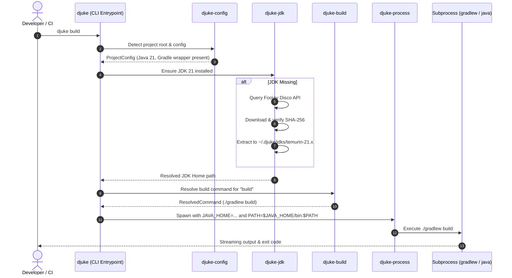
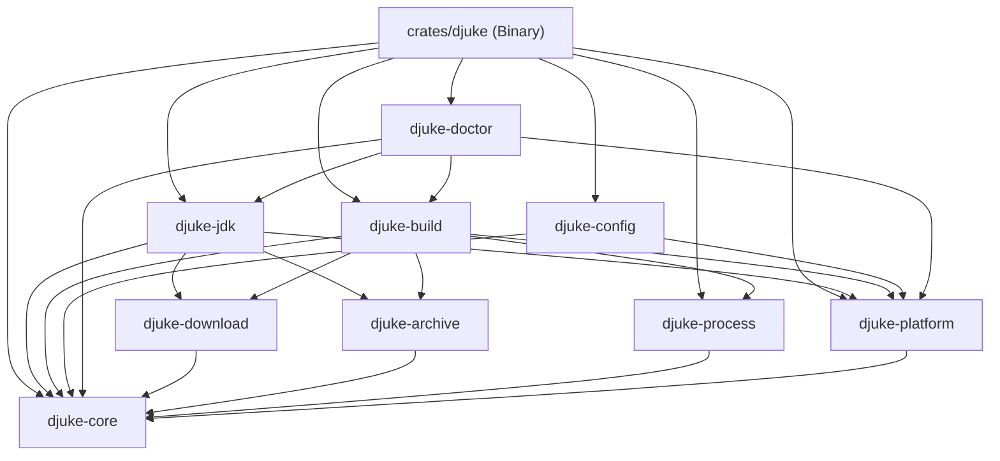

# djuke Architecture & System Blueprint

## 1. High-Level Vision

`djuke` is designed to be the single entrypoint for Java application development. Rather than burdening developers with manual JDK installation, environment variable configuration (`JAVA_HOME`, `PATH`), and build tool synchronization, `djuke` orchestrates these dependencies ephemerally and reliably.

## 2. Core Architectural Principles

1. **Zero Global Pollution**: `djuke` never mutates system-wide registry entries (Windows) or global shell profiles without explicit opt-in. All environment injections (`JAVA_HOME`, `PATH`) are strictly scoped to child process executions or directory-local shell exports.
2. **Wrapper-First Execution**: If a project provides `./gradlew` or `./mvnw`, `djuke` invokes that wrapper directly. It does not re-download Gradle or Maven runtime distributions when wrappers exist.
3. **Decoupled Multi-Crate Boundaries**: To prevent monolithic entanglement and allow parallel subagent engineering, the workspace is partitioned into specialized domain crates.
4. **Resilient Network & I/O**: Checksums (SHA-256) are always verified before archive extraction. Extraction operations are atomic and protected against zip-slip path traversal attacks.

## 3. Data Flow Diagram

## 4. Crate Dependency Graph

